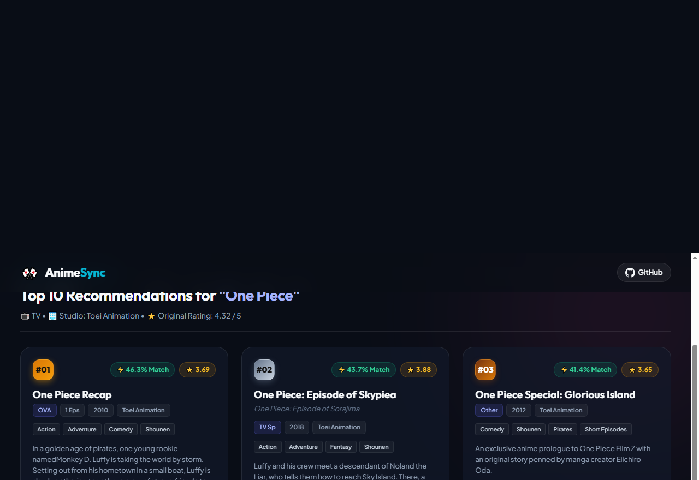

# 🎌 AnimeSync - Anime Recommendation System

A content-based recommendation web application that suggests similar anime titles based on themes, genres, studios, and storylines. Built with **Python**, **Flask**, **Pandas**, and **Scikit-learn**.

[](https://www.python.org/)
[](https://flask.palletsprojects.com/)
[](https://pandas.pydata.org/)
[](https://scikit-learn.org/)
[](https://opensource.org/licenses/MIT)

---

## 📸 Application Preview



---

## ✨ Key Features

- **Content-Based Filtering:** Computes multi-dimensional cosine similarity across metadata features (genres, animation studio, staff, and story synopsis) to recommend relevant titles.
- **Top-10 Ranked Suggestions:** Returns the top 10 most mathematically similar anime shows with match percentages (e.g. `98.4% Match`).
- **Rich Anime Cards:** Displays comprehensive metadata for each suggestion:
  - Match percentage score & star rating
  - Media format (`TV Series`, `Movie`, `OVA`) & episode count
  - Release year & animation studio (e.g. *MADHOUSE*, *ufotable*, *Kyoto Animation*)
  - Genre tag pills (e.g. *Mystery*, *Psychological*, *Shounen*)
  - Clean, formatted synopsis
- **Quick External Actions:** 1-click buttons to look up title details on **MyAnimeList** or stream the trailer on **YouTube**.
- **Interactive Quick-Picks:** Popular search chips (*Death Note*, *Attack on Titan*, *Your Name*, *Steins;Gate*, *One Piece*, etc.) for instant recommendations.
- **Self-Healing Fallback Architecture:** Automatically detects if full model files are present; if missing, falls back to Instant Demo Mode so anyone can clone and test immediately without gigabyte downloads.
- **Modern Glassmorphic Dark UI:** Cyberpunk-inspired dark theme with responsive cards, subtle glow accents, and loading spinners.

---

## 💡 Architecture & Design Highlights

### 1. Dual-Mode Engine (Solving the GitHub 100MB Limit)
* **The Challenge:** The full cosine similarity matrix (`similarity.pkl`) across 18,495 anime titles is **2.73 GB**. GitHub strictly limits individual file uploads to **100 MB**.
* **The Solution:** We engineered an **Automatic Dual-Mode Engine**:
  * **🚀 Full Production Mode (Local):** Automatically detects `anime.pkl` and `similarity.pkl` in the root folder, providing vector querying across all 18,400+ titles in milliseconds.
  * **✨ Instant Zero-Config Demo Mode (GitHub Clones):** If the large model files are absent, the application gracefully activates **Demo Mode** using a lightweight precomputed cache (`demo_data.json`, ~80 KB). Anyone cloning the project can run `python app.py` immediately and test popular anime (*Death Note*, *Attack on Titan*, *One Piece*, *Demon Slayer*, *Steins;Gate*, *Your Name*, etc.) without running into `FileNotFoundError` or memory crashes.

### 2. Text Sanitation Pipeline
* Scraped anime datasets often contain character-level quote wrapping, encoding anomalies, and unescaped characters.
* Implemented a string normalization pipeline in `app.py` that strips formatting artifacts and repairs punctuation while preserving natural English story synopses.

---

## 🛠️ Tech Stack

| Layer | Technology |
| :--- | :--- |
| **Backend** | Python 3.10+, Flask, Werkzeug, Jinja2 |
| **Data Processing & ML** | Pandas, Scikit-learn (Cosine Similarity, Vectorization), Pickle |
| **Frontend** | HTML5, CSS3 (Glassmorphism, Flexbox, CSS Grid), Vanilla JavaScript |
| **Environment & Tools** | Virtualenv, Git, GitHub |

---

## 📂 Project Structure

```text
├── screenshots/
│   └── preview.png          # Clean UI preview screenshot
├── static/
│   └── style.css            # Modern dark glassmorphic styling
├── templates/
│   └── index.html           # Dynamic Jinja2 web template
├── demo_data.json           # Lightweight sample data for instant demo mode
├── app.py                   # Core Flask backend & recommendation engine
├── run_app.bat              # 1-Click launcher for Windows
├── requirements.txt         # Python dependencies
├── .gitignore               # Git ignore rules (excludes 2.7GB model files)
└── README.md                # Project documentation
```

---

## 🚀 Getting Started

Follow these steps to run the application locally on your machine.

### 1. Prerequisites
- **Python 3.10+** installed on your system.
- Git installed.

### 2. Clone the Repository
```bash
git clone https://github.com/Yashbanda18052003/anime-recommendation-system.git
cd anime-recommendation-system
```

### 3. Create and Activate a Virtual Environment
- **Windows (Command Prompt / PowerShell):**
  ```bash
  python -m venv venv
  venv\Scripts\activate
  ```
- **macOS / Linux:**
  ```bash
  python3 -m venv venv
  source venv/bin/activate
  ```

### 4. Install Dependencies
```bash
pip install -r requirements.txt
```

### 5. Datasets & Models (Demo vs. Full Mode)

- **✨ Instant Demo Mode (Works Out-of-the-Box):**  
  The repository includes `demo_data.json` containing verified recommendations for the most popular anime (*Death Note*, *Attack on Titan*, *One Piece*, *Demon Slayer*, *Steins;Gate*, *Your Name*, etc.). Anyone cloning this repository can run `python app.py` immediately without downloading large files!

- **🚀 Full 18,495 Anime Dataset Mode:**  
  To search across the full 18,400+ dataset:
  1. Place the precomputed model files in the project root:
     - `anime.pkl` (Metadata DataFrame)
     - `similarity.pkl` (Cosine Similarity matrix)
  2. The application will automatically detect both files on startup and activate full search across all titles.

### 6. Run the Application
You can run the application using either method:

**Method A: Using Python**
```bash
python app.py
```

**Method B: 1-Click Windows Launcher**
Double-click `run_app.bat` inside the project folder.

### 7. Access in Browser
Open your browser and navigate to:
```
http://127.0.0.1:5000
```

---

## 🧠 How the Recommendation Engine Works

1. **Feature Vectorization:**  
   Metadata features (genres, tags, descriptions, studios, and staff) are vectorized into high-dimensional numerical vectors.
2. **Cosine Similarity Computation:**  
   Cosine similarity calculates the cosine of the angle between two anime feature vectors $A$ and $B$:
   $$\text{Cosine Similarity} = \frac{A \cdot B}{\|A\| \|B\|}$$
   Scores range between `0.0` (unrelated) and `1.0` (identical).
3. **Retrieval & Ranking:**  
   When a user selects an anime:
   - The engine looks up its vector index in $O(1)$.
   - Retrieves similarity scores against all records.
   - Sorts the scores descending (`sorted(..., reverse=True)`) and slices the top 10 nearest neighbors.
   - Cleans the metadata and renders the results via Flask and Jinja2.

---

## 👤 Author

**Yash Banda**
- **GitHub:** [@Yashbanda18052003](https://github.com/Yashbanda18052003)
- **LinkedIn:** [linkedin.com/in/banda-yash-829633259](https://linkedin.com/in/banda-yash-829633259)

---

## 📄 License
This project is open-source and available under the [MIT License](LICENSE).
